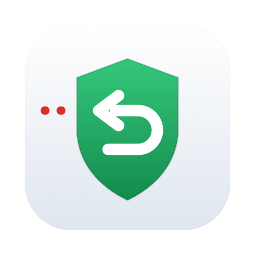

# Keepway



**Ein Wegwerf-Browser für unsichere Websites.** Keepway startet Brave in einem abgeschotteten
Container auf deinem Mac. Du siehst und bedienst ihn ganz normal in einem eigenen Fenster – aber
die Webseiten laufen nicht auf deinem Mac, sondern im Container. Beim Beenden wird alles gelöscht:
Verlauf, Cookies, Cache, Dateien.

Nichts vom Mac kommt auf die Seiten, nichts von den Seiten kommt auf den Mac.

> Für macOS (Apple Silicon) mit [OrbStack](https://orbstack.dev) und Brave.
> Eine Linux-Version gibt es noch nicht – Pull Requests willkommen.

---

## Features

- **Wegwerf-Browser** – jeder Start ist frisch, beim Beenden ist alles weg.
- **Kein Zugriff auf deine Dateien** – der Container sieht keinen Ordner vom Mac.
- **Downloads gesperrt** (bzw. im Labor-Modus nur im Container), **keine Datei-Uploads**.
- **Werbe-, Tracker- und Cookie-Banner-Blocker** (Brave Shields), Cookie-Banner werden nie bestätigt.
- **Weiterleitungs-Sperre** – schickt dich eine Seite ungefragt auf eine fremde Website,
  erscheint eine Sperrseite mit „Trotzdem öffnen“.
- **Mining-Erkennung** – CPU-Verbrauch pro Seite, Worker-Zähler, Warnung bei hoher Last.
  Dazu ist WebAssembly komplett aus (darüber laufen fast alle Browser-Miner).
- **Dashboard im neuen Tab**: deine aktuelle IP mit Anbieter und Ort (Warnung, wenn das VPN aus ist),
  Download- und Upload-Versuche, blockierte Weiterleitungen, Verbrauch pro Seite, Lesezeichen.
- **VPN-Check beim Start**.
- **Labor-Modus** zum Herunterladen und Prüfen verdächtiger Dateien – ohne dass sie den Container verlassen.
- **Keepway.app** mit eigenem Icon (hell/dunkel/getönt, macOS wählt selbst) – Start ohne Terminal.
- **Wöchentliche Update-Frage** für Brave.

## Installation

1. [OrbStack](https://orbstack.dev) und [Brave](https://brave.com) installieren.
2. Repo klonen, in den Ordner wechseln.
3. `./sb` ausführen. Beim ersten Start wird das Brave-Image einmalig geladen (~1,2 GB),
   danach startet alles lokal in Sekunden.

Beim ersten Start erzeugt Keepway einen **eigenen Signierschlüssel** für seine Erweiterung
(`docker/keys/`, nie im Repo). Jeder Klon hat dadurch eine andere Erweiterungs-ID –
nichts ist bei zwei Installationen gleich.

## Benutzung

```bash
./sb            # starten (oder Fenster öffnen, falls er schon läuft)
./sb labor      # Labor-Modus starten (siehe unten)
./sb stop       # beenden – alles im Container wird gelöscht
./sb update     # neue Brave-Version holen
./sb status     # läuft er? wie alt ist Brave?
./sb log        # Container-Log
```

Oder **Keepway.app** doppelklicken bzw. ins Dock ziehen. Läuft Keepway schon, fragt die App,
ob du es beenden oder das Fenster öffnen willst. Die App muss im Keepway-Ordner bleiben
(ins Dock ziehen geht, nach „Programme“ kopieren nicht).

Der Ordner funktioniert an jedem Ort – `./sb` findet seinen Pfad selbst.

### Labor-Modus

`./sb labor` erlaubt Downloads und die Dateiauswahl – aber **nur im Container**. So kannst du
z. B. eine verdächtige Datei herunterladen und bei VirusTotal hochladen. Das Dashboard zeigt
groß „🧪 Labor-Modus“ und listet die heruntergeladenen Dateien. Kein Datei-Transfer zum Mac,
Zwischenablage nur Richtung Container. `./sb stop` löscht alles.
(Windows-Programme laufen im Linux-Container nicht, ein Terminal gibt es nicht.)

### Updates

Sicherheitsupdates für Brave kommen **nicht automatisch** – das Image bleibt lokal, damit der
Start schnell ist und nichts ungefragt geladen wird. Stattdessen fragt `./sb` einmal pro Woche:
„Nach neuer Brave-Version suchen?“. Bei Ja werden nur die geänderten Teile geladen (meist
100–300 MB) und das Image lokal neu gebaut. Danach einmal `./sb stop` und neu starten.
Jederzeit manuell: `./sb update`.

### Einstellungen

Beim ersten Start wird `einstellungen.json` aus `einstellungen.beispiel.json` angelegt
(bleibt lokal, nicht im Repo):

| Feld | Bedeutung |
|---|---|
| `lesezeichen` | feste Lesezeichen im neuen Tab (nur `http`/`https`) |
| `heim_provider` | Teil des Namens deines Internet-Anbieters → rote Warnung, wenn das VPN aus ist |
| `erlaubte_weiterleitungen` | Ziel-Domains, auf die ohne Rückfrage weitergeleitet werden darf |
| `cpu_warnung_prozent` | ab welchem Ø-Verbrauch eine Seite als „hoher Verbrauch“ markiert wird |
| `cpu_kerne`, `arbeitsspeicher_gb` | Obergrenze für den Container (schützt den Mac vor Minern) |

## Wie es funktioniert

```
 Mac                                         OrbStack (Linux-VM)
┌──────────────────────────────┐            ┌───────────────────────────────────────────┐
│ Keepway-Fenster              │  Bild +    │ Container „keepway“ (frisch bei jedem Start)│
│ (eigenes Brave-Profil,       │◀─ Ton ─────│  Brave + Keepway-Erweiterung               │
│  kann NUR keepway.orb.local) │── Maus/ ──▶│  Firewall: lokales Netz gesperrt          │
│                              │   Tasten   │  ──▶ Internet (über dein VPN)              │
└──────────────────────────────┘            └───────────────────────────────────────────┘
```

Das Fenster zeigt nur einen **Bildstream**. Der Code der Webseiten läuft ausschließlich im Container.

### Schutzschichten

1. **Linux-VM** (OrbStack, Apple Virtualization) – der Container läuft nicht direkt auf macOS.
2. **Container ohne Ordner vom Mac** – nur zwei Einstellungsdateien, schreibgeschützt.
3. **Kein Port am Mac** – erreichbar nur über `keepway.orb.local`, nur von diesem Mac.
   Fremde Webseiten werden von der Oberfläche abgewiesen (Origin-Prüfung).
4. **Brave-Sandbox an** (im Basis-Image aus): Namespace + seccomp. Fehlt sie, startet Brave nicht.
5. **Container gehärtet**: fast alle Linux-Rechte entfernt, `no-new-privileges`, kein sudo, kein Terminal,
   Speicher-/CPU-/Prozess-Limit, ungenutzte Weiterleitungen im Webserver entfernt.
6. **Firewall im Container**: Router, NAS, der Mac und alles im lokalen Netz sind gesperrt.
   Ohne aktive Firewall startet Brave nicht.
7. **Abgeriegeltes Fenster**: eigenes Brave-Profil (in `~/Library/Application Support/Keepway`,
   damit macOS keinen Ordnerzugriff braucht), ohne Erweiterungen, ohne Schlüsselbund.
   Alles außer `keepway.orb.local` geht auf einen toten Proxy – das Fenster erreicht weder das
   Internet noch deine localhost-Apps. Darum **immer über `./sb` öffnen, nicht in einem normalen Tab**.
8. **Zwischenablage nur Mac → Container** und nur über das Feld in der Seitenleiste.
   Kein Datei-Transfer, keine Teilen-Links, kein Mikro, keine Kamera.
9. **Brave-Richtlinien** ([docker/policies.json](docker/policies.json)): Downloads und Dateiauswahl gesperrt,
   JavaScript-JIT aus (damit auch WebAssembly), WebGL aus, XSLT aus, PDFs werden nicht gerendert,
   Zugriff auf lokales Netz gesperrt, nur HTTPS, Zertifikatsfehler nicht übergehbar, WebRTC-IP-Leak-Schutz,
   keine Passwörter/Autofill, Cookies nur für die Sitzung, fremde Erweiterungen gesperrt.
10. **Brave Shields**: Werbe-/Tracker-Blocker, Cookie-Banner-Blocker, Miner-Listen.

### Grenzen

- JIT aus macht JavaScript-lastige Seiten langsamer; WebAssembly-Seiten (Spiele, manche Tools) gehen nicht.
- Brave und der Stream-Server laufen im Container als derselbe Nutzer. Bricht ein Angreifer aus Braves
  Sandbox aus, kontrolliert er auch den Stream – deshalb ist das Fenster am Mac abgeriegelt.
- Weiterleitungen werden erkannt, *nachdem* die Zielseite zu laden beginnt – ein paar Millisekunden Skript
  können dort laufen (im Container).
- CPU pro Seite ist eine Schätzung (gemessen wird der ganze Browser, während die Seite sichtbar ist).
- Kein VPN-Kill-Switch: fällt das VPN aus, geht der Verkehr über deine normale Leitung.
- Programme auf deinem Mac selbst können `keepway.orb.local` erreichen (aber nichts aus dem Netzwerk).

## Projektaufbau

| Pfad | Inhalt |
|---|---|
| `sb` | Startskript |
| `Keepway.app` | Starter fürs Dock |
| `docker/Dockerfile` | Image auf Basis von `lscr.io/linuxserver/brave` |
| `docker/policies.json` | Brave-Richtlinien (Vorlage, ID wird pro Klon eingesetzt) |
| `docker/vorbereiten.py` | Schlüssel erzeugen, Vorlagen füllen, Einstellungen prüfen |
| `docker/firewall.sh`, `docker/wrapped-brave` | Firewall, Brave-Start mit Sandbox |
| `docker/seccomp-brave.json` | seccomp-Profil (aus `make-seccomp.py` + Docker-Standardprofil) |
| `extension/` | Keepway-Erweiterung: Dashboard, Weiterleitungs- und Mining-Wächter |
| `icon/` | Icon (SVG), Icon-Composer-Paket, `baue-icons.sh` |

## Mitmachen

Issues und Pull Requests sind willkommen – z. B. für eine Linux-Version.
Mit einem Pull Request erlaubst du Kontaa5, deinen Beitrag in Keepway zu verwenden,
zu ändern und weiterzugeben (siehe [LICENSE](LICENSE)).

## Lizenz

Alle Rechte vorbehalten – siehe [LICENSE](LICENSE). Ansehen und Issues schreiben ist ausdrücklich erwünscht.
Brave, OrbStack und linuxserver.io gehören ihren jeweiligen Inhabern; Keepway steht in keiner Verbindung zu ihnen.
